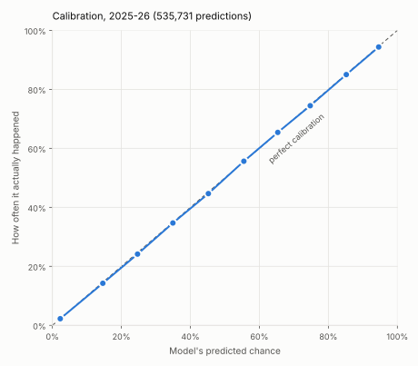

# NBA prop model

[](https://github.com/akilatrades/nba-prop-model/actions/workflows/tests.yml)

A pricing model for NBA player props (points, rebounds, assists, threes),
tested against a full season of Kalshi prices with the betting rule written
down before any price was downloaded. A sister project to my
[NFL parlay model](https://github.com/akilatrades/nfl-parlay-model).

<!-- MARKET RESULT -->

| Phase | What it adds | Status |
|---|---|---|
| 1 | A full range of outcomes for each player stat, from minutes, per-minute rates, the betting line, the opponent and teammates who are out; walk-forward backtest | Done |
| 2 | Test against Kalshi's 2025-26 prices at tip-off, after fees, with the rule fixed in advance | Done |
| 3 | Live: Kalshi price log and model prices for every open prop, from opening night | Running |

## Phase 1: the model

**On the 2025-26 season, run once after the model was frozen, its
probabilities were calibrated to within about half a percentage point in
every band, and it beat each player's own recent average on all four stats.**
The gain is about 2% overall but under 1% for heavy-minute players, the ones
Kalshi lists.



| Stat | Player-games | Typical miss: model vs recent average | Brier improvement | Log loss improvement | Players averaging 26+ minutes: Brier improvement |
|---|---:|---:|---:|---:|---:|
| Points | 25,511 | 4.70 vs 4.80 | 2.0% | 2.2% | 0.8% |
| Rebounds | 25,511 | 1.92 vs 1.96 | 2.3% | 2.4% | 0.8% |
| Assists | 25,511 | 1.38 vs 1.41 | 2.0% | 2.3% | 0.5% |
| Threes made | 25,511 | 0.93 vs 0.94 | 1.6% | 1.6% | 0.9% |

"Typical miss" is the mean absolute error of the expected value. Brier score
and log loss score the probabilities at five lines per stat (for points
10+, 15+, 20+, 25+, 30+ and 35+); the improvement is relative to a baseline
that uses each player's own recent average with the same spread of outcomes,
so the comparison isolates what the extra pre-game information adds. The
development seasons (2021-22 to 2024-25) gave the same picture:
[development](outputs/backtest/development/summary.csv),
[holdout](outputs/backtest/holdout/summary.csv),
[by line](outputs/backtest/holdout/by_line.csv).

## How it works

1. **Data** ([`fetch_data.py`](fetch_data.py)): ESPN box scores for every player
   and game since 2017-18, including who did not play and why, and the
   consensus closing spread and total for each game since 2020-21, from the
   sportsdataverse hoopR data repository.
2. **Pre-game features, from earlier games only**
   ([`features.py`](nba_model/features.py)):
   - *Minutes:* recent minutes (half-life of five games), minutes last game,
     share of recent starts, team games missed since he last played,
     back-to-backs, playoffs, and the size of the spread (big favourites rest
     starters late).
   - *Rates:* points, rebounds, assists and three-point attempts per minute
     over his last 30 games, shrunk toward his position's rate from earlier
     seasons by 150 minutes of average play.
   - *Game:* the team's implied points from the closing total and spread, and
     what the opponent has allowed in each stat relative to the league.
   - *Teammates out and back:* the share of the team's recent minutes and of
     each stat that belongs to regulars (15+ minutes) who played in the
     team's last three games but are out tonight, split by position group,
     and the share belonging to regulars returning tonight.
3. **Expected value** ([`marginals.py`](nba_model/marginals.py)): a Poisson
   regression per stat, with seasons weighted so one three years older counts
   half as much.
4. **Range of outcomes:** the distribution of actual ÷ expected in the latest
   three seasons, kept separately for ten bands of expected value within three
   tiers of recent minutes (under 20, 20–30, 30+). This keeps the real shape,
   including zero-three nights and 40-point games.
5. **Backtest** ([`evaluate.py`](nba_model/evaluate.py)): refit before every
   calendar month on all earlier games, scored on the month it has not seen.

<!-- MARKET SECTION -->

## Live use

Three scheduled workflows run during the season:

- [`kalshi.yml`](.github/workflows/kalshi.yml) saves every open Kalshi NBA
  prop market each morning and before each evening's tip-offs
  ([`log_kalshi.py`](log_kalshi.py)), into `data/kalshi/`.
- [`projections.yml`](.github/workflows/projections.yml) refreshes the box
  scores, reads ESPN's schedule, lines and injury report (Out and Doubtful
  players sit), refits the models and prices every open Kalshi prop
  ([`run_projections.py`](run_projections.py)). Output:
  [`outputs/projections/latest.csv`](outputs/projections/) with the model's
  expected value and probability, Kalshi's bid and ask, and the edge on each
  side after fees.
- [`backfill.yml`](.github/workflows/backfill.yml) downloaded the settled
  2025-26 markets and their hourly prices for the market test
  ([`scripts/backfill_kalshi.py`](scripts/backfill_kalshi.py)).

## Reproduce

```bash
pip install -r requirements.txt
python fetch_data.py               # box scores, schedules and lines (about 10 MB)
python run_backtest.py             # development seasons; --holdout for 2025-26
python run_market_test.py          # needs data/kalshi_history/ from the backfill
pytest                             # unit tests on synthetic games, no data needed
```

[`RESEARCH_LOG.md`](RESEARCH_LOG.md) records every decision in order,
including the market test as written before any price was seen.

## Limitations

- In the backtest, "teammates out" uses who actually sat. A final injury
  report shows most of that before tip-off but not late scratches, so the
  backtest has a small head start the live model will not; the market test
  reports results with those features switched off.
- The model does not know tonight's starting lineups or minutes limits
  announced shortly before tip-off. The market does.
- Hourly Kalshi candles give the best bid and ask, not the size behind them.
- One season of Kalshi prices is a short record for a small edge.

## AI use

I used AI tools to help write code and documentation and to review my work.
I reviewed the analytical assumptions, methods and results and remain
responsible for the claims made here.

## License

MIT. Box scores and lines come from the sportsdataverse hoopR data
repository; Kalshi prices from Kalshi's public API.
